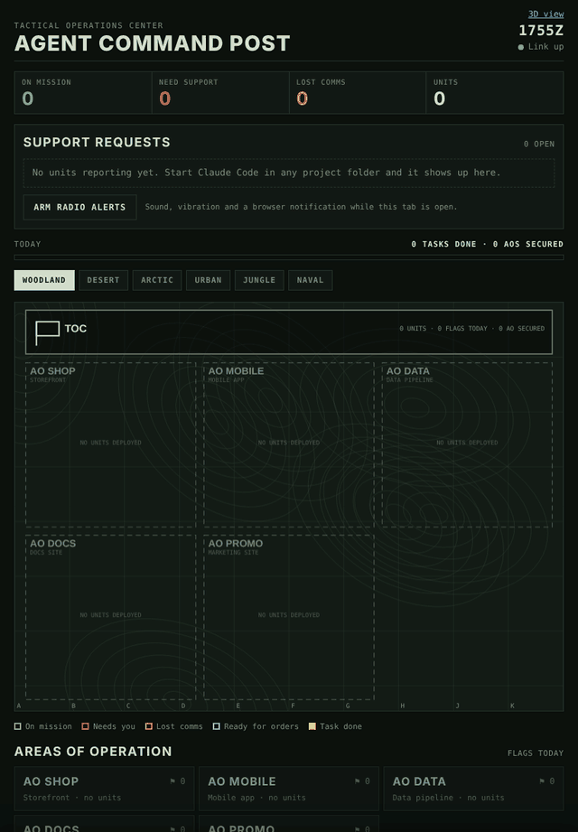

# Agent Command Post

**A tactical operations center for your Claude Code agents.**

Your agents live on a little hex planet. Each project is a base on its own tile, each Claude Code session is an astronaut that walks out of the space station to its project, and the ones that are stuck wave at you with a speech bubble. Click one and it opens its Claude Code session. Pick a terraformed world, the Moon, or Mars. The original tactical map is still there as the classic view.

Run five, ten or twenty Claude Code sessions at once and you lose track fast. Which one is stuck on a permission prompt? Which one asked you a question twenty minutes ago? Which one quietly died? Agent Command Post puts every session on one live military-style map, so you can see who's on mission, who needs you, and who went silent.



*The classic tactical view running `node demo.js`.*

- **Units are your agents.** Every Claude Code session shows up as a unit in the area of operation (AO) for its project folder.
- **Support requests come to you.** Permission prompts and agent questions go to the top of the page with a radio call, a desktop notification, and optionally a push to your phone.
- **Lost comms.** If a working agent stops reporting for 5 minutes, it's flagged. Stalled and crashed agents never ask for help, so this catches the failures you'd otherwise miss.
- **Flags come from real work.** Each item an agent checks off its own to-do list plants a flag. When every agent in an AO finishes its list, the sector is **SECURED**.
- **After-action report.** A daily card with tasks completed, sectors secured, support calls answered, and your average response time.
- **Six theaters.** Woodland, desert, arctic, urban, jungle, and naval.

Everything runs on your machine. There are no accounts and no dependencies, and nothing leaves your computer unless you turn on phone alerts.

## Install

You need Claude Code and Node.js 18 or newer. Tested on Linux. It should also work on macOS, but without the background service: the installer starts the server directly instead.

```bash
git clone https://github.com/YOUR-USERNAME/agent-command-post.git
cd agent-command-post
./install.sh
```

Then open **http://localhost:7600**.

The installer:
1. Copies the app to `~/.agent-command-post/app` and creates `~/.agent-command-post/config.json`.
2. Backs up `~/.claude/settings.json`, then adds the command post's hooks. Your existing settings and hooks are kept.
3. Starts the server as a systemd user service, so it comes back on login.

Restart any Claude Code sessions that were already open so they pick up the hooks.

**See it work without real agents:**

```bash
node ~/.agent-command-post/app/demo.js
```

Five fake agents deploy, work through their task lists, ask you questions, and plant flags. Press Ctrl+C to stop the demo and clear them from the board.

## How it works

Claude Code [hooks](https://docs.claude.com/en/docs/claude-code/hooks) send each session event to a tiny local server. The page listens to the server and redraws the map.

| Claude Code event | On the map |
|---|---|
| Session starts | Unit deploys to its AO, ready for orders |
| You send a prompt | Unit moves out, on mission |
| Tool use | Unit stays on mission and shows what it's doing |
| Permission prompt, or the agent asks you a question | **Needs support.** Red alert, radio call, notification |
| No events for 5 min while working (20 min inside a long command) | **Lost comms.** Amber alert |
| To-do item checked off | Flag planted |
| Turn ends | Unit returns to camp, ready for orders. Tap it to give new orders |
| Every unit in an AO has finished its to-do list | AO **SECURED** |
| Session ends | Unit leaves the board. Its flags stay for the day |

Tap a unit to see its orders, its task list, its last action, and a copyable `claude --resume` command to jump back into that session.

The hook is a 30-line script that forwards the event and exits. It never prints anything, never blocks Claude, and never changes a decision. If the server is down, it exits quietly.

## Answer agents from the board

Tap any agent on the map. Its card says what it's doing in plain words. If it's waiting on you, the card shows its question with a box for your answer, plus one-tap Yes and No buttons for yes-or-no questions. If it's ready for orders, type its next task.

Your message goes into that agent's session as if you'd typed it there. The installer adds a small Claude Code plugin, `command-post-relay`, that checks the board for your messages every 15 seconds while the agent waits on you (every 45 while it works) and hands them to the agent.

This works for Claude Code sessions on the same computer as the command post. Cloud sessions can't reach your computer, so they don't appear on the board.

## Map your projects

By default, each top-level folder in your home directory gets its own AO. To name them yourself, edit `~/.agent-command-post/config.json`:

```json
"projects": [
  { "code": "SHOP",   "name": "Storefront", "match": ["storefront", "shop"] },
  { "code": "MOBILE", "name": "Mobile app", "match": ["mobile-app"] }
]
```

A session belongs to the first project whose `match` text appears anywhere in its folder path. The server picks up changes on its own, no restart needed.

## Alerts

- **On the page:** tap **Arm radio alerts** to get a sound, vibration and a browser notification for each new support call.
- **Desktop:** on Linux, alerts also show as system notifications (`notify-send`). Set `"desktopNotifications": false` to turn them off.
- **Phone push (optional):** set `"ntfyTopic"` to a long random name and subscribe to that topic in the free [ntfy](https://ntfy.sh) app. By default the push only says which unit needs you. Set `"ntfyIncludeDetails": true` to include the agent's question. That text then passes through the ntfy server, so use your own ntfy server if your prompts are sensitive.

## View it from your phone on the same Wi-Fi

Set `"lanAccess": true` in the config and restart the service:

```bash
systemctl --user restart agent-command-post
```

Then open `http://YOUR-COMPUTER-IP:7600/?key=YOUR_ACCESS_KEY`. The installer generates the key and saves it in the config. Without the key, other devices get nothing. Only turn this on for networks you trust, because the page shows your prompts.

The board only answers to `localhost`, IP addresses and your computer's own name, which blocks DNS-rebinding attacks. If you open it by another name (a `.local` alias or a Tailscale name, say), add that name to `"allowedHosts"` in the config. Requests from other websites open in your browser are always refused, so a web page can't send orders to your agents.

## Settings

| Key | Default | What it does |
|---|---|---|
| `port` | `7600` | Port for the page and the hooks |
| `lostCommsMinutes` | `5` | Silence before a working agent is marked lost comms |
| `lostCommsInToolMinutes` | `20` | Same, while a single command is running |
| `staleHours` | `8` | Units silent this long are taken off the board |
| `flagsHours` | `24` | How long planted flags stay on the map |
| `showIdleProjects` | `true` | Show configured projects that have no units yet |
| `allowedHosts` | `[]` | Extra host names the board answers to |

## Uninstall

```bash
./install.sh --uninstall
```

This removes the hooks and the service. Your settings backup and `~/.agent-command-post` stay where they are.

## Limits

- Messages from the board arrive within 15 to 45 seconds, not instantly.
- Multiple-choice question popups inside a session still need an answer in that session.
- Flags only come from agents that keep a to-do list, which Claude Code does for multi-step work.
- Lost comms is based on time. A single command that runs longer than 20 minutes will raise a false alarm.

## License

MIT
